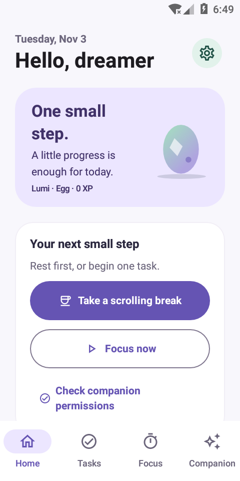
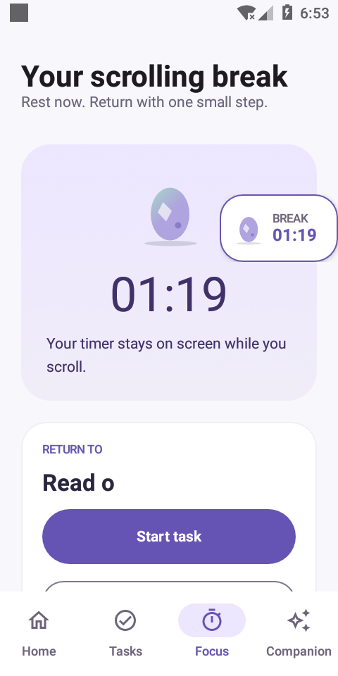
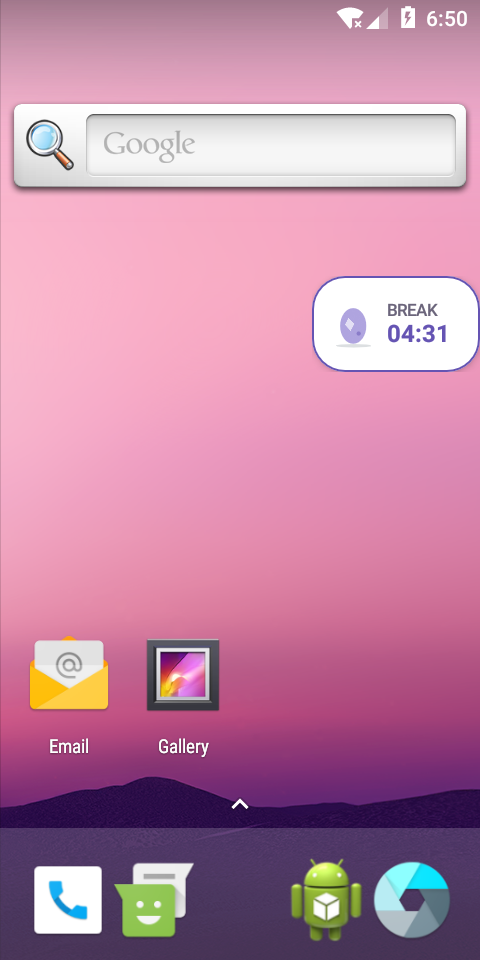

# KIN

A native Android productivity companion for finding your way back to your goals.
Small adventures, a gentle fantasy creature, and focus without perfect streaks.

**Status: native Android 0.8 development build with offline backup/restore, selectable timer alerts, a persistent scrolling-break countdown, a break → reminder → focus cycle and native focus Picture-in-Picture.** Build/test evidence is recorded in VALIDATION.md. Physical-device and OEM acceptance remain separate checks; this is not the complete master specification. See [validation evidence](docs/VALIDATION.md) and the [remaining milestones](docs/ROADMAP.md).

## Download

[Download KIN 0.8 debug APK](downloads/KIN-debug.apk?raw=true) · Android 8.0 or later.

This is an early debug build, not a production release. Android may ask you to allow installation from your browser or file manager. The matching SHA-256 is in [downloads/KIN-debug.apk.sha256](downloads/KIN-debug.apk.sha256). The checked-in APK is built from this branch's app source; subsequent documentation-only commits do not change its code. It uses the existing signing certificate and explicit database migrations from schema 1/2 to 3 for in-place updates. Known missing features are listed below and in the roadmap.

## Implemented in source

- First-open permission guidance followed by direct entry to Home. Companion naming is optional; tasks and goals can be added when needed.
- Four main tabs: Home, Tasks, Focus and Companion. World and chat live under Companion; Settings opens from the Home gear. Interfaces are native components inspired by the supplied six-screen reference.
- Room-backed task creation, editing, deletion, completion, date/time rescheduling, ten-minute snoozing, category search, goal associations, priority, estimated duration, and per-task reminders. Today shows three pending priority tasks by default; additional tasks remain accessible. Overdue tasks stay in Today.
- Daily/weekly/monthly recurring tasks, persistent actionable subtasks, native date/time pickers, and task-specific Start/Snooze/Options notifications. Completing or skipping creates one next future occurrence; skipped tasks award no XP. See [offline planner behavior](docs/OFFLINE_PLANNER.md).
- Locally stored personal goals, motivations, achievements, and companion XP. Completing the same task, focus session, or goal cannot award XP twice. Deleting a goal unlinks its tasks without deleting them. Deleting a memory does not remove earned XP.
- First-open permission setup, notification request, battery guidance and a real sample window over the home screen. The setup also appears once when upgrading from 0.5 and remains available from Home/Settings.
- A shared, movable companion countdown for break and focus: the running/paused break stays visible inside KIN and over ordinary apps, with remaining time visible before tapping. Drag to either edge, tap for controls, tap outside to collapse, and restore the saved position after app switching/recovery. [Behavior and limits](docs/MOVABLE_TIMER.md).
- A consistent lavender/white/sage palette, clearer task rows, a compact Home companion banner, a live timer summary and calmer Focus screens. [Design review and public competitor references](docs/DESIGN_REVIEW.md).
- Preset durations, task/goal lists, quick scheduling choices, remembered recent choices and short onboarding reduce routine typing.
- A separate planned-break timer with a chosen return task/goal, large companion prompt over other apps, goal-linked five-minute snoozing, a focus-duration picker, pause/stop controls and notification fallback. Completed focus offers another break. [Cycle behavior and Android limits](docs/BREAK_FOCUS_CYCLE.md).
- Focus presets (5, 15, 25, 45 minutes), custom duration (1–180 minutes), pause/resume, task association, and saved completed/interrupted sessions. Monotonic time and a persisted boot count protect active countdown accuracy across process recreation and wall-clock changes. Active sessions are interrupted on reboot without awarding XP; paused sessions can be resumed. Finishing early awards no XP.
- Native Android Picture-in-Picture for an active or paused focus session, with companion/task/countdown, System UI pause/resume and finish controls, expansion back to Focus, availability/settings handling, and coordination that hides an existing floating overlay. Dismissing PiP preserves the session. See [PiP behavior and limits](docs/PICTURE_IN_PICTURE.md).
- An original Canvas-rendered creature with breathing, blinking, waving, sleeping, and celebration poses; six visible evolution stages. Reduced motion freezes animations. A lightweight painted-vector world gains a cottage and flowers with progression.
- Offline guided chat with contextual templates, emotional shortcuts, conversation history, and honest disclosure that it is not AI or mental healthcare. “I can't start” offers small steps that can be edited and saved to a task, rest, and short focus sessions.
- WorkManager task reminders and focus-completion work; optional notification permission; quiet hours; a global task-reminder pause; dark mode and companion naming in DataStore. Android may delay background notifications.
- Optional draggable WindowManager companion with the same original creature renderer, expansion/collapse, quiet-hour and lock-screen hiding, saved position, and persistent Pause/Stop controls. Optional selected-app foreground-time reminders with explicit Usage access, configurable thresholds and snoozing; all processing is local. See [how to enable it and what it measures](docs/FLOATING_COMPANION.md).
- Selectable sound + vibration, vibration-only or silent timer alerts, distinct original break/focus chimes, quiet-hour/DND handling, real test alerts, gentle/firm reminder wording and optional snooze lengths/limits.
- Versioned backup/restore through Android's document picker, with validation, replacement confirmation, preserved rewards/history, stopped imported clocks and refreshed future reminders. Save a backup before uninstalling.
- A one-minute timer-check guide for actual phones and a [complete offline handover](docs/OFFLINE_RELEASE.md).
- No registration, ads, analytics, cloud provider, API keys, or network permission. Android automatic backup is disabled. File backups are saved only where you choose.

Automatic reminder escalation, additional world progression, and several other requirements remain unimplemented. Overlay and usage-monitoring behavior on newer Android/OEM phones still requires acceptance testing. Compilation and unit checks do not establish all Android lifecycle and device behavior.

## Technology and architecture

- Kotlin 2.1.21, Jetpack Compose / Material 3, Navigation Compose.
- Gradle Kotlin DSL, Gradle 8.13, Android Gradle Plugin 8.10.1; Java 17 bytecode.
- Room 2.7.1, Preferences DataStore 1.1.7, WorkManager 2.10.1.
- Android 8.0+ (API 26), compile/target SDK 35.

```text
app/src/main/java/app/kin/
  data/       Room entities, DAO, database, repository, preferences
  domain/     XP, evolution, countdown math, quiet hours, offline responses
  features/   ViewModel; manual application-scoped dependency injection
  services/   WorkManager, notifications, floating service and usage polling
  ui/         Native screens, theme, original creature and landscape rendering
```

Repositories own data mutations; the ViewModel exposes observable state. Room transactions guard rewards and session completion. The database is version 3, with exported schemas and explicit migrations from versions 1 and 2 under `app/schemas`. Add explicit migrations for future schema changes. Destructive migration fallback is intentionally absent.

## Build

Use Android Studio with JDK 17 or 21, Android SDK command-line tools, platform 35 and build-tools 35.0.0. Ensure `ANDROID_HOME` points to your SDK, or create an untracked `local.properties` with `sdk.dir=/absolute/path/to/sdk`.

```sh
sdkmanager 'platforms;android-35' 'build-tools;35.0.0' 'platform-tools'
./gradlew --no-daemon testDebugUnitTest assembleDebug
```

APK, **after a successful build**: `app/build/outputs/apk/debug/app-debug.apk`.

In this cloud environment, the home directory is read-only. Set a writable Gradle cache first:

```sh
export GRADLE_USER_HOME=/workspace/.cache/kin-gradle
cd /workspace/kin_-adhd_-companion
./gradlew --no-daemon testDebugUnitTest assembleDebug
```

### Wrapper and cloud setup

The official Gradle 8.13 wrapper is included for Unix and Windows. The wrapper JAR was verified against Gradle's published SHA-256; the distribution checksum is pinned in wrapper properties.

For the managed Linux cloud environment, `scripts/install-cloud.sh` installs a checksum-verified JDK 17 and Android command-line tools into `/workspace/.cache`, then installs the required SDK packages and runs the build/tests/lint. Source `scripts/cloud-env.sh` in each new shell to activate the retained toolchain, proxy and system CA trust. Network commands and Gradle's local daemon require the supported sandbox escalation in this environment; the default sandbox cannot reach the proxy. Use the existing checkout; each cloud task is already isolated and needs no worktree.

## Tests

```sh
./gradlew testDebugUnitTest          # domain unit tests
./gradlew connectedDebugAndroidTest # needs an Android emulator/device
./gradlew lintDebug
```

Tests cover evolution boundaries, rewards, countdown math, snooze bounds, quiet hours, offline responses, recurrence boundaries, actual Room persistence after reopening, concurrent exactly-once task completion, goal deletion, snoozing, schema migration, actionable steps, real notification actions, and navigation across major screens. The suite now also tests app-time accounting, cooldowns, actual overlay attachment, quiet-hour hiding/resuming, notification stopping, permission revocation and permission-settings availability. Current counts and platform limits are recorded in VALIDATION.md. See [validation evidence](docs/VALIDATION.md) for device-test status and the manual checks still needed for background timers, notification denial, reboot, battery restrictions, large fonts, and accessibility.

## GitHub Actions and APK download

[The Android workflow](.github/workflows/android.yml) configures Java and the Android SDK, runs unit tests, builds a debug APK, and uploads `KIN-debug-apk`. A hardware-accelerated matrix runs persistence, migration, navigation, notification and overlay instrumentation tests on API 26 and 35 emulators. Test reports are uploaded separately. Jobs use read-only repository permissions and no private signing keys.

After a workflow succeeds, open the run under **Actions → Android debug APK** and download its APK artifact. You can also trigger the workflow manually. The tested debug APK linked above is published directly in `downloads/`; Actions artifacts are separate.

## Permissions

- `POST_NOTIFICATIONS`: optional in first-open permission setup and Settings. Denial leaves tasks, chat, progression, and the timer usable; system notification settings remain available.
- `RECEIVE_BOOT_COMPLETED`: used by the WorkManager dependency to restore scheduled work. KIN does not auto-launch an activity after reboot.
- `SYSTEM_ALERT_WINDOW`: optional Settings permission for the user-started floating companion. Denial leaves core features usable.
- `PACKAGE_USAGE_STATS`: optional Settings/AppOps access for app-time reminders, separately enabled after selecting apps. It does not identify scrolling or content types.
- `FOREGROUND_SERVICE` and `FOREGROUND_SERVICE_SPECIAL_USE`: user-started companion/timer services and ongoing controls. The timer service supports Android process recovery; reopening KIN also recovers an active saved timer. Force-stop and vendor restrictions can still suspend background execution.
- `VIBRATE`: normal Android permission for optional timer-alert vibration.
- No accessibility service, exact alarm, microphone, Internet, storage, or location permission is requested by KIN.

WorkManager contributes normal `WAKE_LOCK`, `ACCESS_NETWORK_STATE`, and `FOREGROUND_SERVICE` permissions plus its internal non-exported receiver permission in the merged manifest. The optional floating mode starts its declared foreground service. KIN does not acquire its own wake lock.

Reminders use deferrable WorkManager jobs, not exact alarms. Quiet-hour task reminders are skipped rather than deferred. This build provides one scheduled notification per occurrence with Start, Snooze 10 min and Options actions. Options includes breakdown, rescheduling and skip. Break reminders offer gentle/firm wording and optional snooze limits. Automatic reminder escalation is not implemented.

## Screenshots

Earlier 0.7 APK captures from a disposable Android 8 emulator with synthetic sample data and the starting Egg companion. These are runtime screens, not the supplied concept reference.

| Home | Active break | Floating countdown |
| --- | --- | --- |
|  |  |  |

Cross-app interaction, expiry and larger-font behavior are covered separately in the [validation record](docs/VALIDATION.md).

## Remaining work

See [ROADMAP.md](docs/ROADMAP.md) for honest acceptance status, including newer-device overlay/usage acceptance, production artwork, reminder escalation, more world unlocks, additional creature motions, accessibility/device validation, and release preparation. This early version is not a complete implementation of the master specification.
